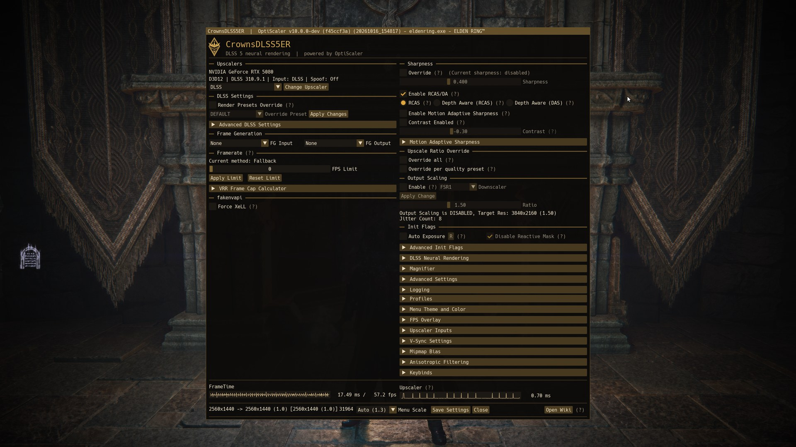
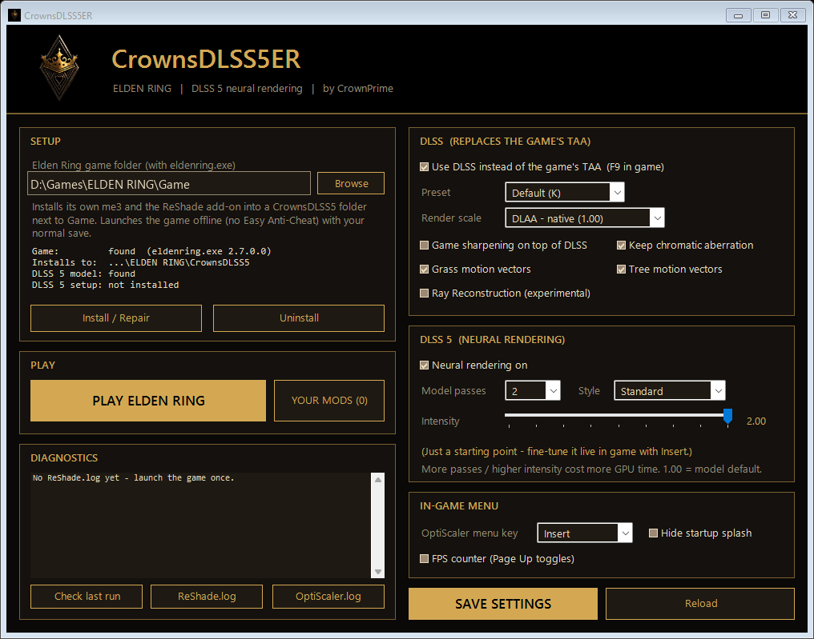
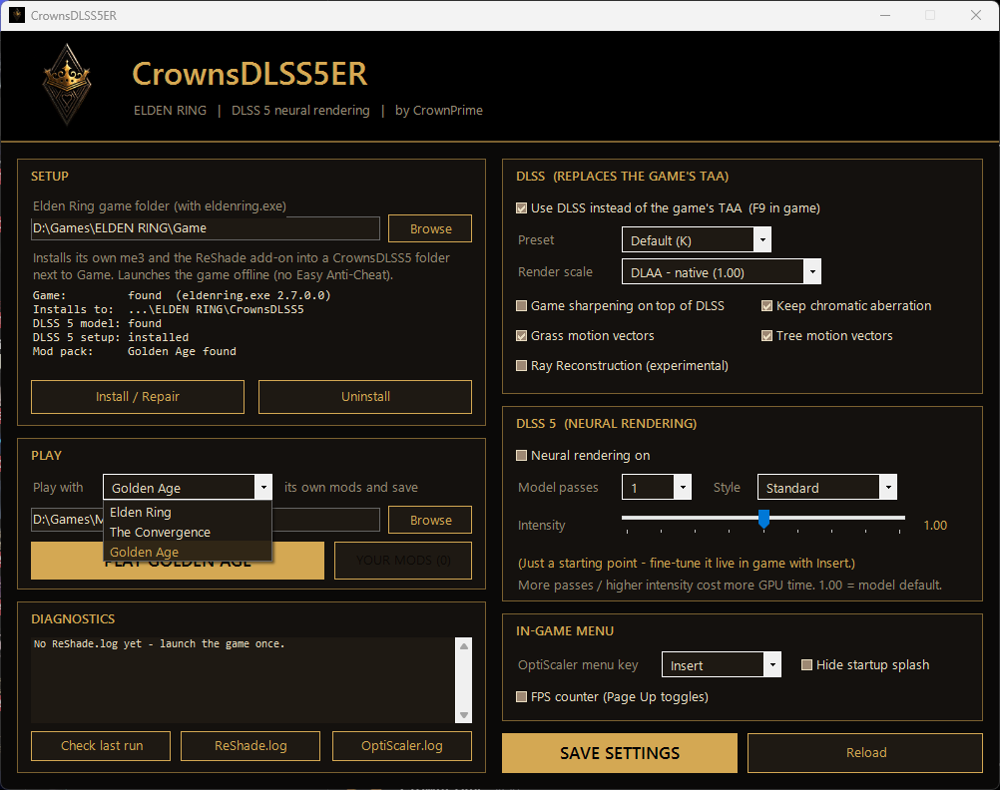

# CrownsDLSS5ER

DLSS 5 for ELDEN RING. Hooked in at the right place.

*by CrownPrime*





## Why

Generic DLSS 5 tools run the model on the finished frame. In Elden Ring that means the HUD goes through it too, and
motion has to be guessed. Result: smeared UI, ghosting.

This runs DLSS 5 at the game's own TAA pass, through Mason Petrosky's
[EldenRingDLSS](https://github.com/masonpetrosky/EldenRingDLSS) add-on, so:

- the UI is drawn after, and stays clean
- it gets real motion vectors and depth, including grass and trees (the add-on generates those; the game doesn't)
- the TAA is replaced with actual DLSS, so DLSS 5 starts from a clean image

The EldenRingDLSS add-on and the OptiScaler DLSS-NR fork didn't run together out of the box. Two fixes:
[`patches/`](patches/).

## Requirements

- NVIDIA RTX, driver 616.56+
- ELDEN RING `eldenring.exe` 2.7.0 / 2.7.1
- Windows 10 / 11
- `nvngx_dlssnr.dll`, which you get yourself

## The model

`nvngx_dlssnr.dll` (310.8) is NVIDIA's. Not included, not linked. Get your own and put it in `pack\files\Game\`.

Tested hashes (`Get-FileHash .\nvngx_dlssnr.dll`):

```
RTX 50        E16BCF15E16E13F527491CDF7845B2FE6521A738D8F7C9C721866A8496E1FC8E
RTX 20/30/40  E67DEE209320CDAFE0E93E45675D7AA34323A53ACC57A72B2E40A181581C989A
```

Background: the [DLSS-NR fork's install guide](https://github.com/wilsjo2/OptiScaler-DLSSNR-PreSR-Multipass/blob/main/INSTALL-DLSSNR.md).
If a hash doesn't match, don't use it. Without the model you still get DLSS, just not DLSS 5.

## Use

1. Extract the [release](../../releases) zip and add the model.
2. Run `CrownsDLSS5ER.bat`.
3. **Install / Repair**, then **PLAY**.

`Insert` DLSS 5 menu · `Home` ReShade / DLSS · `F9` DLSS on/off

**Check last run** tells you if it all actually kicked in.

## Mods

**YOUR MODS** loads folder and DLL mods, top to bottom, after the DLSS 5 setup. There's an optional
separate save. Don't add another ReShade or upscaler.



## Notes

- Offline only, no EAC. Seamless Co-op is fine.
- Back up `%APPDATA%\EldenRing`.
- No Steam? Install with `pack\Install-Vanilla.ps1 -GameDir "...\Game" -SkipSteamInit`.
- DLSS 5 here is an unofficial NVIDIA feature. Experimental.

## Next

More FromSoftware games on me3 (Nightreign, AC6, DS3), tested presets, and getting the fixes upstream.

## Build

```
powershell -ExecutionPolicy Bypass -File tools\Build-Release.ps1 -Source "<pack>" -Version 1.0.0
```

Strips the model and anything personal. Binaries live in Releases, not git.

## Credits

[EldenRingDLSS](https://github.com/masonpetrosky/EldenRingDLSS) (Mason Petrosky) ·
[OptiScaler DLSS-NR](https://github.com/wilsjo2/OptiScaler-DLSSNR-PreSR-Multipass) (wilsjo2, OptiScaler team) ·
[ReShade](https://reshade.me) (Patrick Mours) · [me3](https://github.com/garyttierney/me3) (garyttierney)

## License

MIT for my code ([LICENSE](LICENSE)). Bundled parts keep theirs ([notices](THIRD-PARTY-NOTICES.md)). The modified
OptiScaler is GPL-3.0. Source:
[`crownsdlss5er`](https://github.com/CrownPrime/OptiScaler-DLSSNR-PreSR-Multipass/tree/crownsdlss5er).

Uses NVIDIA DLSS. NVIDIA and DLSS are NVIDIA trademarks. ELDEN RING belongs to FromSoftware / Bandai Namco. A fan
project, not affiliated with any of them.
